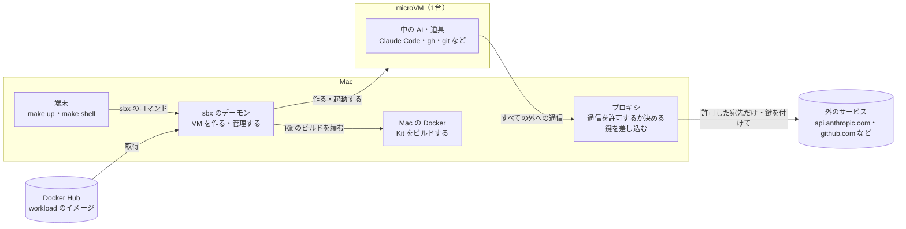
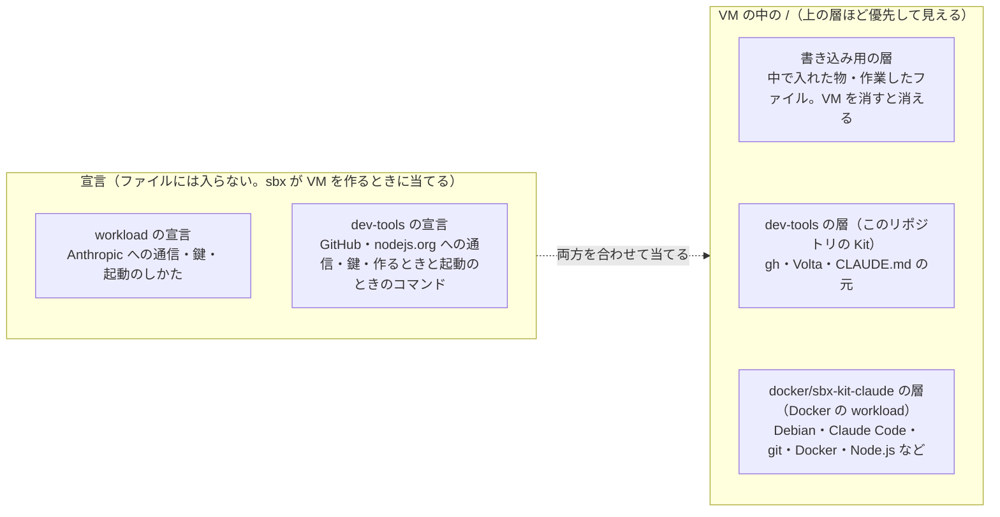
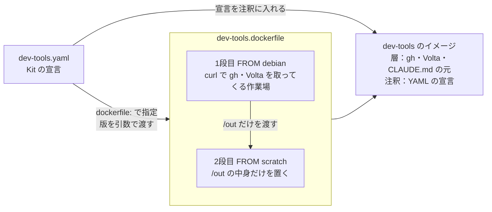
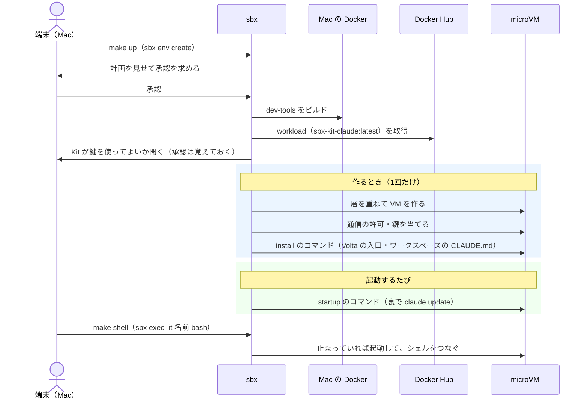
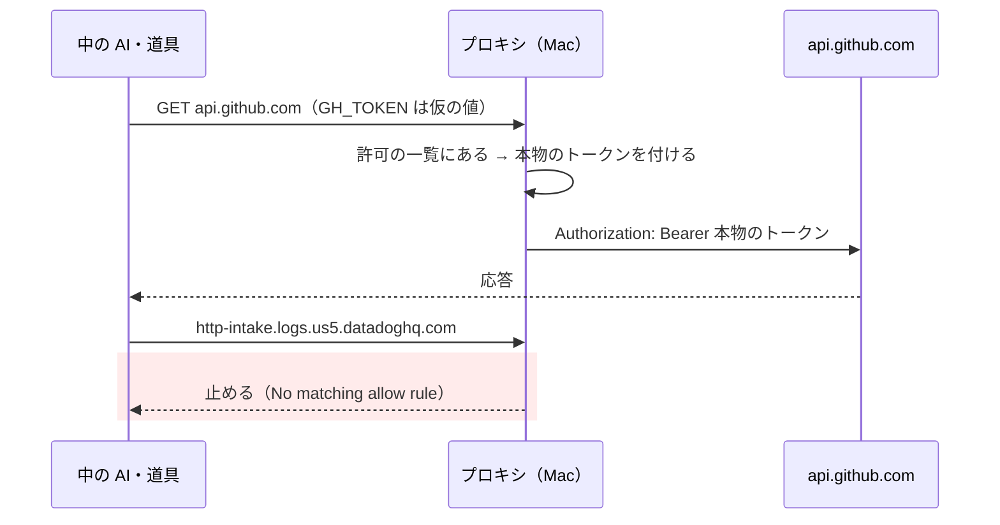
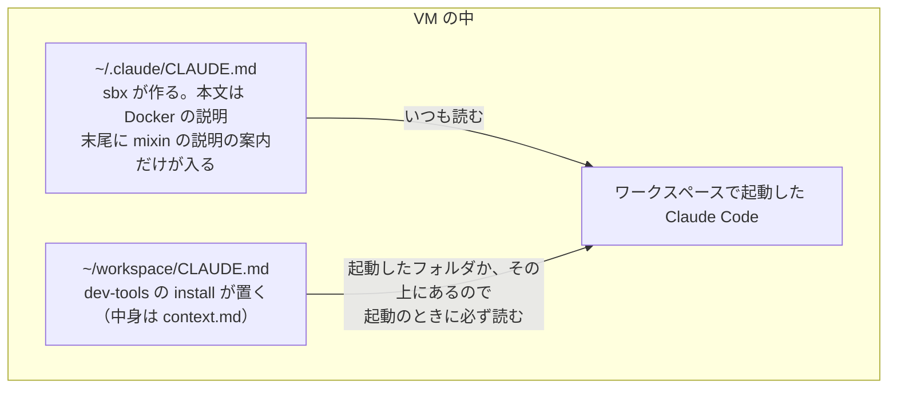
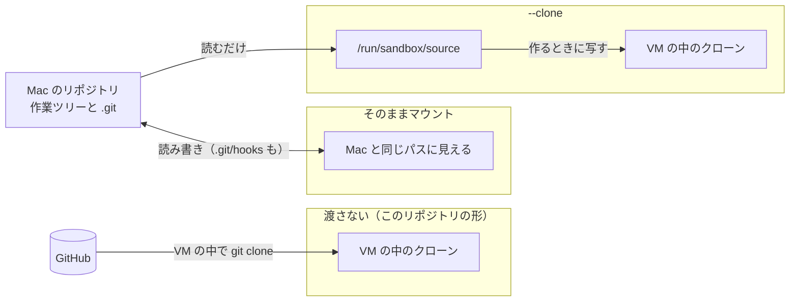

# Docker Sandboxes の動き

sbx 0.49.2（2026-10-23）で確かめた内容です。sbx は試験中の機能が多く、版が上がると変わることがあります。

## 全体の形



- VM の外への通信は、すべて Mac のプロキシを通ります。許可していない宛先は止められます
- 鍵（トークン）はプロキシが通信に付けます。VM の中に本物の鍵は入りません

## VM の中身は Kit を重ねて作る



- Kit には2種類あります。土台の workload（VM に1つだけ）と、上に重ねる mixin（いくつでも）です。dev-tools は mixin です
- Kit は「ファイルの層」と「宣言（YAML）」のセットです。宣言はイメージのファイルではなく、イメージの送り状（マニフェスト）の注釈 `vnd.docker.sandbox.kit.descriptor` に載ります
- そのため、Dockerfile の `FROM docker/sbx-kit-claude` で作り直すと、ファイルは受け継げても宣言は受け継げません。土台はコマンド（ここでは sbxenv.yaml の `kits`）で指定して重ねます
- 中身を見るには `sbx kit inspect docker.io/docker/sbx-kit-claude:latest` を打ちます

## Kit のビルド



- ビルドは sbx が Mac の Docker に頼んで行います。自分で `docker build` する必要はありません
- 最後の段を `FROM scratch` にしているのは、Debian 一式が workload の上に重なって、ベースのファイルを上書きしないようにするためです
- `/home/agent` の下のファイルは、層には置かず、作るときのコマンドで置きます。層に置くと、`/home/agent` のフォルダの持ち主が上書きされるおそれがあるからです

## 作ってから使うまで



- 鍵を承認しないと、鍵が差し込まれないまま作られます。承認は `~/.config/sbx/credentials.yaml` に残ります
- install のコマンドは作るときに1回、startup のコマンドは起動のたびに動きます。startup の記録は VM の中の `/var/log/sbx-kit-startup.log` です

## 通信の許可と鍵



- 許可の一覧は、Mac の全体の設定（`sbx policy init balanced` など）と、各 Kit の宣言を合わせたものです
- 止められた通信は `sbx policy log 名前` で見られます。例：Claude Code の利用統計の送り先（Datadog）は、どこにも許可がないので止められます
- 差し込んだトークンでできることは、中の AI もできます。トークンの権限を絞るのが、いちばん効く対策です

## 中の AI への説明（CLAUDE.md）



- Kit の `agent-context@1` で説明を渡すと、mixin の説明は本文に入らず、案内の1行になります。読むかどうかは Claude 次第です
- 本文に入れる `agent-context@2` は、sbx 0.49.2 では「unsupported capability type」になり使えません
- そのため、dev-tools は context.md をワークスペースの `CLAUDE.md` として置いています

## Mac のフォルダの渡し方



- `sbx run` はパスを書かないと、今いるフォルダをマウントします。`sbx create`・`sbx env create`（`make up`）は、パスを書かなければマウントしません
- そのままマウントすると、中の AI が `.git/hooks` を書き換え、Mac で `git commit` したときにそれが動きます
- `--clone` でも、Mac のファイルは読めます。`.env` などの秘密は中から見えます

## 版の上がり方

- workload は `latest` を使っています。ただし `latest` は毎回更新されません（10/23 時点で `latest` は 2.1.291、最新のタグは 2.1.296）
- Claude Code 本体は、起動のたびに `claude update` で最新になります（`latest` の 2.1.291 から 2.1.309 に上がりました）。結果は VM の中の `/tmp/claude-update.log` です
- 組み込みの `sbx run claude` は、別の古い形のイメージ（`docker/sandbox-templates:claude-code-docker`）を使います。workload の Kit ではないので、dev-tools は重ねられません

## よく使うコマンド

```sh
sbx ls                                  # VM の一覧
sbx exec -it 名前 bash                   # VM のシェル（make shell と同じ）
sbx policy log 名前                      # 止められた通信・通った通信
sbx kit inspect docker.io/docker/sbx-kit-claude:latest   # Kit の宣言の中身
sbx env plan                            # make up で何が作られるか（作らない）
```

## 参考

- [Docker Sandboxes](https://docs.docker.com/ai/sandboxes/)
- [Kits](https://docs.docker.com/ai/sandboxes/customize/kits/)
- [Isolation（マウントの方式と危険）](https://docs.docker.com/ai/sandboxes/security/isolation/)
- [Kit の仕様 v3（docker/sandbox-kit-spec）](https://github.com/docker/sandbox-kit-spec/blob/main/docs/spec/SPEC-v3.md)
